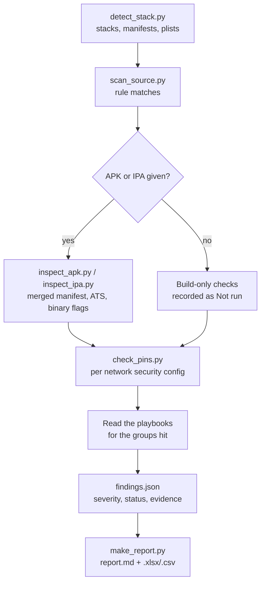

# masvs

A Claude Code plugin for OWASP MASVS mobile security audits, pentest/VAPT prep and remediation of auditor findings, for Flutter, native Android, native iOS and React Native apps.

[](LICENSE)
[](NOTICE)
[](https://mas.owasp.org/MASVS/)
[](https://mas.owasp.org/MASWE/)
[](https://www.python.org/)

Every finding is filed under a MASVS control (what the app must achieve) and an OWASP MASWE weakness (what went wrong), with the evidence behind its status.

## Why use it

- **Evidence first.** Every status records how it was established: `verified`, `inferred` or `manual`. `Fixed` and `Already mitigated` are only accepted with verified evidence from a built APK/IPA or a live endpoint, so the report won't claim a fix the pentester can break on retest.
- **Checks the whole bundle.** Pentesters test what ships. The skill audits native Android and iOS code, app extensions and widgets inside a Flutter or React Native repo, not only the Dart or JavaScript.
- **Output auditors can use.** It writes `findings.json`, a Markdown report and an Excel sheet (or CSV) whose columns match a typical VAPT findings sheet: observation, impact, severity, status, response, evidence, re-test build, ticket, MASVS control and MASWE weakness.
- **Safe by default.** The scripts run locally, use only the Python standard library and make no network calls, except `check_pins.py --host`, which connects to the host you name. Known token formats and long literals are redacted in every output.

## Modes

| Mode | When to use it | Example prompt |
|---|---|---|
| `audit` | No findings yet: before a pentest, before a release, or to see where you stand | "Run a MASVS audit of this app before the pentest" |
| `remediate` | You have an auditor's report, findings sheet or security tickets | "Here is the VAPT sheet. Map each finding to MASVS and MASWE, fix what's real and fill in the response column" |
| `checklist` | You are building a feature and want to get it right first time | "I'm adding biometric login on Flutter. What MASVS/MASWE checks apply?" |

## Quick start

1. Install the plugin in Claude Code (other options are under [Installation](#installation)):

   ```text
   /plugin install masvs --marketplace Sammug/masvs-skill
   ```

2. Open your app's repo in Claude Code and ask:

   ```text
   Run a MASVS audit of this app. The release APK is at build/app/outputs/flutter-apk/app-release.apk.
   Write the report and an xlsx.
   ```

3. Collect the output from `<app>/.masvs/`:

   ```text
   <app>/.masvs/
   ├── findings.json   # one row per finding and per remaining MASVS control
   ├── report.md       # summary by severity and status, then the findings table
   └── report.xlsx     # or report.csv when openpyxl isn't installed
   ```

> [!IMPORTANT]
> Add `.masvs/` to your app's `.gitignore`. The report holds security findings and should not be committed.

### Example output

An excerpt of `report.md` for a synthetic app. The full example is in [docs/examples/report.example.md](docs/examples/report.example.md), rendered from [docs/examples/findings.example.json](docs/examples/findings.example.json).

| Finding | MASVS Control | MASWE | Severity | Status | Evidence |
|---|---|---|---|---|---|
| Backups enabled | MASVS-STORAGE-2 | MASWE-0006 (Sensitive Data Not Excluded From Backup) | Medium | Open | [verified] inspect_apk.py app-release.apk: allow_backup: true |
| Cleartext only in debug config | MASVS-NETWORK-1 | MASWE-0026 (Network Traffic Not Encrypted) | Info | False positive | [inferred] git ls-files android/app/src: the only usesCleartextTraffic="true" is in src/debug/AndroidManifest.xml; src/main/AndroidManifest.xml has no override |
| Certificate pins expired | MASVS-NETWORK-2 | MASWE-0028 (Insecure Identity Pinning) | Medium | Open | [inferred] check_pins.py --nsc network_security_config.xml --today 2026-11-19: expiration 2025-06-30, days_left -507, backup_pin true |
| Exported service without permission | MASVS-PLATFORM-1 | MASWE-0018 (Lack of Authentication or Authorization on App Components) | High | Fixed | [verified] inspect_apk.py app-release-4.2.1.apk: exported[] no longer lists com.example.wallet.sync.SyncService |
| Root/jailbreak detection | MASVS-RESILIENCE-1 | MASWE-0051 (Root/Jailbreak Detection Not Implemented) | Info | Not run | [manual] no rooted/jailbroken test device: runtime check not run |
| Binary protections (iOS) | MASVS-CODE-3 | MASWE-0045 (Compiler-Provided Security Features Not Used) | Info | Not run | [manual] no APK/IPA: inspect_ipa.py not run |

## Installation

| Method | Commands | Notes |
|---|---|---|
| In a Claude Code session (2.1.275 or later) | `/plugin install masvs --marketplace Sammug/masvs-skill` | One command adds the marketplace and installs the plugin. |
| In a Claude Code session (older versions) | `/plugin marketplace add Sammug/masvs-skill`<br>`/plugin install masvs@masvs-skill` | Same result in two steps. |
| From a shell | `claude plugin marketplace add Sammug/masvs-skill`<br>`claude plugin install masvs@masvs-skill --scope project` | `--scope project` records the plugin in the repo's settings for everyone on it; leave it out to install for yourself only. |
| For a whole team | Commit the snippet below to the app's `.claude/settings.json` | Anyone who opens the repo in Claude Code is prompted to install the plugin. |
| Without plugins | Download `masvs-<version>.zip` from [Releases](https://github.com/Sammug/masvs-skill/releases) and unzip it into `~/.claude/skills/` (every project) or `<app>/.claude/skills/` (one app) | A plain skill: invoke it as `/masvs`. |

Team settings snippet:

```json
{
  "extraKnownMarketplaces": {
    "masvs-skill": { "source": { "source": "github", "repo": "Sammug/masvs-skill" } }
  },
  "enabledPlugins": { "masvs@masvs-skill": true }
}
```

An install from inside a session is either active straight away or asks you to run `/reload-plugins`. A shell install loads the next time Claude Code starts, or after `/reload-plugins` in a running session.

### Invoking it

Ask in plain language. Claude loads the skill on its own when you mention MASVS, MASWE, a pentest, VAPT, a mobile security audit or an auditor's findings. To call it directly, type `/masvs:masvs` followed by your request (plugin skills are namespaced). With a zip install, the command is `/masvs`.

More prompts and every way to run the skill, including headless and CI, are in [docs/USAGE.md](docs/USAGE.md).

## How an audit works



Scanner output is **matches, not findings**. Claude reads the playbook for each MASVS group that was hit, confirms or dismisses each match, assigns severity and status, and adds a row for every MASVS control that has no finding, so the report covers all 24 controls.

## Evidence model

| Evidence kind | Meaning | Examples |
|---|---|---|
| `verified` | A script or command run on a built artifact or a live endpoint showed it | `inspect_apk.py`, `inspect_ipa.py`, `check_pins.py --host` |
| `inferred` | Source, config or a scan showed it | the source manifest, `build.gradle`, `scan_source.py`, `check_pins.py --nsc` alone |
| `manual` | Nothing has exercised it yet | server-side auth, IDOR, hooking, runtime behaviour |

The six statuses are `Open`, `Fixed`, `Already mitigated`, `False positive`, `Risk accepted` and `Not run`. `make_report.py` rejects `Fixed` and `Already mitigated` without verified evidence, `Fixed` without a `retest_build`, and `False positive` with only manual evidence. The pass/fail mapping and severity scale are summarised in [docs/REFERENCE.md](docs/REFERENCE.md#evidence-status-and-severity); [skills/masvs/SKILL.md](skills/masvs/SKILL.md) is the authoritative source.

## Requirements

| Need | For | Without it |
|---|---|---|
| Python 3.9+ | Every script (standard library only) | Nothing runs. |
| `openpyxl` (optional) | `report.xlsx` | `make_report.py` writes `report.csv` instead. |
| `openssl` | `check_pins.py --host` and `--chain` (SPKI hashes) | Those modes return `{"skipped": ...}`; `--nsc` alone still works. |
| Android SDK `aapt2` or `apkanalyzer` | `inspect_apk.py` | APK checks return `{"skipped": ...}` and are reported as `Not run`. Found on `PATH`, under `ANDROID_HOME`/`ANDROID_SDK_ROOT`, or in the default SDK locations. |
| macOS with `otool`, `plutil`, `unzip` | `inspect_ipa.py` | IPA checks return `{"skipped": ...}` and are reported as `Not run`. |
| `zip` | `scripts/package.sh` (maintainers only) | Packaging the release zip fails. |

A missing tool never fails a run: the script exits 0 with `{"skipped": "<reason>"}` and the check is listed as `Not run` with that reason.

## Documentation

| Document | What's in it |
|---|---|
| [docs/USAGE.md](docs/USAGE.md) | Every way to run the skill, prompt examples per mode, headless runs, running the scripts directly, a CI example |
| [docs/REFERENCE.md](docs/REFERENCE.md) | Script CLIs and output keys, exit codes, the `findings.json` format and validation rules, scanner behaviour, data files |
| [docs/TROUBLESHOOTING.md](docs/TROUBLESHOOTING.md) | Symptoms, causes and fixes |
| [CONTRIBUTING.md](CONTRIBUTING.md) | Adding a scan rule, releases, regenerating the MASWE catalog |
| [evals/README.md](evals/README.md) | Pressure scenarios for testing the skill itself |

## Coverage

- **MASVS v2.1.0**: all 24 controls across the eight groups (STORAGE, CRYPTO, AUTH, NETWORK, PLATFORM, CODE, RESILIENCE, PRIVACY).
- **MASWE v1.0.0**: all 78 weaknesses, with requirement, platforms, CWE, modes of introduction and mitigations. The catalog is generated from the [OWASP/maswe](https://github.com/OWASP/maswe) release tag, not edited by hand.
- **MASTG**: candidate tests for each control, linked through shared MASWE IDs. Claude cites one only after reading it and confirming it applies.
- **Scan rules**: 52 rules in [skills/masvs/data/rules.json](skills/masvs/data/rules.json).

  | Stack | Rules |
  |---|---|
  | Android | 19 |
  | Flutter | 11 |
  | iOS | 7 |
  | React Native | 4 |
  | Any stack (`*`: committed secrets, keystores, service-account keys) | 11 |

> [!NOTE]
> **One weakness, several controls.** The MASWE index on mas.owasp.org lists each weakness under one primary control, but many weaknesses map to several controls through their `masvs-v2` mappings. For example, MASWE-0018 is filed under MASVS-AUTH-1 and also maps to MASVS-PLATFORM-1 and MASVS-STORAGE-2. The skill uses the full mapping, so `make_report.py` accepts MASVS-PLATFORM-1 with MASWE-0018 without a warning. MASWE profiles (L1, L2, R, P, EUDIW) are not used yet.

## Privacy

The scripts run on your machine and make no network calls, except `check_pins.py --host`, which opens a TLS connection to the host you name. Known token formats (AWS, GitHub, GitLab, Google, Slack, Stripe, JWT, private keys) and long quoted literals are redacted to their first 4 characters in the JSON, Markdown and spreadsheet output. Claude is instructed never to output a secret's value, and to keep client data (hostnames, bundle IDs, pins, app names) out of web searches.

## Updating

Plugin install: refresh the marketplace, then update the plugin.

```text
/plugin marketplace update masvs-skill
```

Then update `masvs` from `/plugin` → **Installed**, or from a shell:

```bash
claude plugin update masvs@masvs-skill
```

Zip install: replace the `masvs/` folder with the one from the newer zip.

The version is in [.claude-plugin/plugin.json](.claude-plugin/plugin.json) and in `metadata.version` in [skills/masvs/SKILL.md](skills/masvs/SKILL.md).

## Development

```bash
python3 -m venv .venv && .venv/bin/pip install pytest openpyxl
.venv/bin/pytest -q
MASVS_DENYLIST="word1,word2" .venv/bin/pytest -q tests/test_references.py   # no client identifiers
scripts/package.sh                                                          # writes dist/masvs-<version>.zip
```

To add a scan rule or cut a release, see [CONTRIBUTING.md](CONTRIBUTING.md). To test the skill's behaviour under pressure, see [evals/README.md](evals/README.md).

## Attribution

Control IDs, summaries and links come from [OWASP MASVS](https://mas.owasp.org/MASVS/), [MASTG](https://mas.owasp.org/MASTG/) and [MASWE](https://mas.owasp.org/MASWE/), licensed CC BY-SA 4.0. Control summaries are paraphrased; MASWE titles and requirements are quoted. See [NOTICE](NOTICE). The skill's own code is Apache-2.0 ([LICENSE](LICENSE)).

This project is not affiliated with or endorsed by OWASP.
